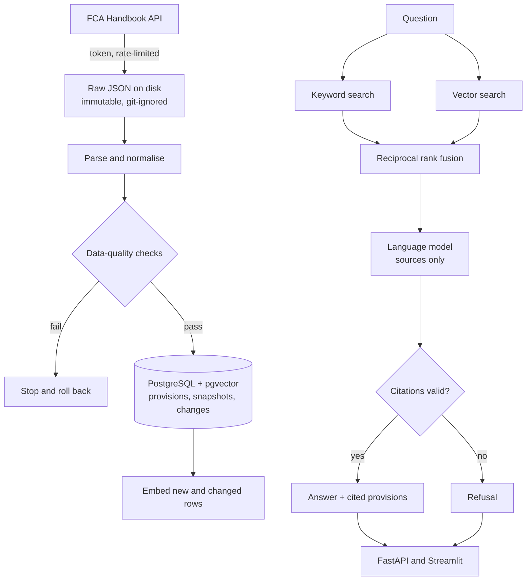

# FCA Handbook Q&A

Ask a question about the FCA's consumer credit rules and get an answer that cites the exact
provision it came from, or an honest "I could not find this".

I work part-time in an FCA-regulated pawnbroking shop, where questions like "what do we have to
check before agreeing a loan?" come up and the answer lives somewhere in a very long rulebook.
This project is my attempt to make that rulebook searchable without trusting a language model
more than it deserves.

> Information only, not legal or regulatory advice. Always check the official Handbook.

## What it does

- **Ingests** a Handbook sourcebook through the official Handbook API (no scraping), keeps the
  untouched response on disk, and loads one row per provision into PostgreSQL.
- **Checks data quality** before writing: duplicate IDs, empty bodies and suspicious drops in
  row count stop the run and roll it back.
- **Tracks changes.** The API only serves the current Handbook, so every run is stored as a
  snapshot and compared with the last one. Added, changed and removed provisions are logged
  with the old wording.
- **Searches three ways**: keyword (Postgres full-text), vector (pgvector) and hybrid (both,
  merged with reciprocal rank fusion).
- **Answers with citations.** The model may only use retrieved provisions. Code then checks
  every citation: an answer that cites nothing real is replaced by a refusal.
- **Measures itself** on a hand-written question set, including questions it should refuse.

## Architecture



## Results

<!-- Replace this section with your own numbers from `python -m fcaqa eval`. -->

Evaluated on **N** questions I wrote from the sourcebook (**N** answerable, **N** deliberately
out of scope), top 5 results.

| Mode | hit@1 | hit@5 | MRR | Cited correct | False refusal | Correct refusal |
|---|---|---|---|---|---|---|
| keyword | | | | | | |
| vector | | | | | | |
| hybrid | | | | | | |

What I learned from the numbers: _write two or three honest sentences here, including what did
not work._

## Run it

You need Docker and Python 3.11 or newer.

```bash
make install        # virtualenv + dependencies
cp .env.example .env
make up             # Postgres with pgvector
make demo           # loads a small synthetic rulebook twice and asks a question
make test           # unit tests, plus integration tests if the database is up
```

`make demo` uses invented data for a fictional tool library, so the whole pipeline can be seen
working with no API token and no model. See [docs/SETUP.md](docs/SETUP.md) for loading the real
Handbook and connecting a language model.

## Project layout

```
src/fcaqa/
  handbook_api.py   API client: auth, retries, pagination
  parse.py          raw records -> clean provisions, content hashing
  ingest.py         quality checks, snapshots, change log, embeddings
  retrieve.py       keyword, vector and hybrid search
  answer.py         prompt, citation checking, refusals
  evaluate.py       metrics and reports
  api.py            FastAPI service
  cli.py            command line
sql/schema.sql      tables and indexes
app/                Streamlit UI
eval/               question sets and results
tests/              unit and integration tests
```

## Design decisions

- **One provision is one searchable unit.** The Handbook is already divided into numbered
  provisions, so there is no arbitrary chunking, and a citation points at something a person
  can look up.
- **Plain SQL, no framework.** Retrieval is two SQL queries and one small fusion function, so
  every step can be read and tested.
- **The model reads, code decides.** Refusals come from rules (no valid citation, similarity
  below a threshold), not from hoping the model behaves.
- **No Handbook text in this repository.** Raw snapshots are git-ignored. The repo holds code,
  synthetic demo data and my own questions.

## Limitations

- Long provisions are embedded as a single unit and truncated, so detail deep inside a long
  rule or table can be missed.
- The question set is written by one person and reflects what I thought to ask.
- Change tracking starts from my first snapshot. Earlier history is not available from the API.
- It covers one sourcebook.

## Data and licence

Handbook content is accessed through the FCA Handbook API under its terms and the Open
Government Licence v3.0. This project is not affiliated with or endorsed by the FCA. Code is
released under the MIT licence.
# fca-handbook-qa
